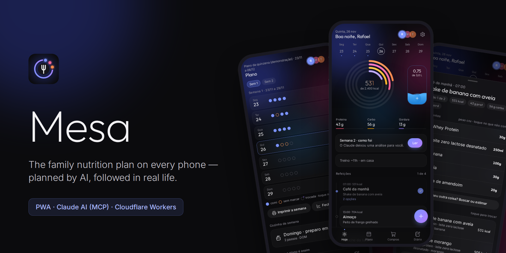
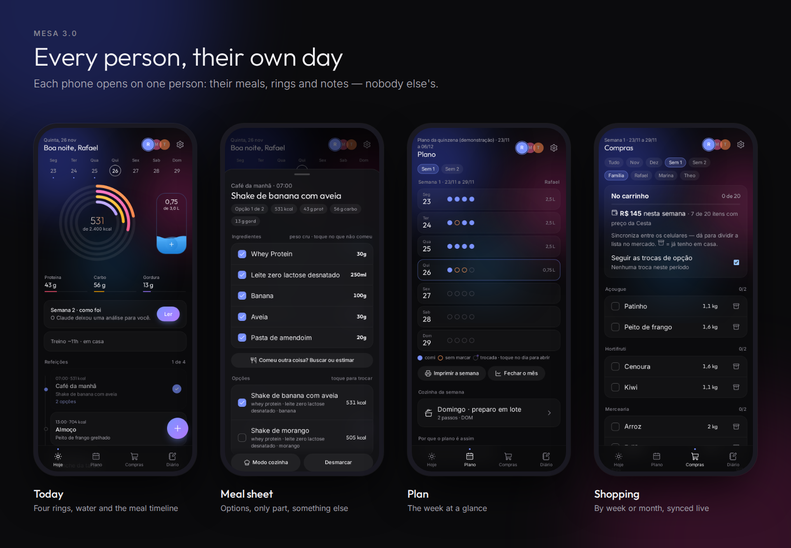
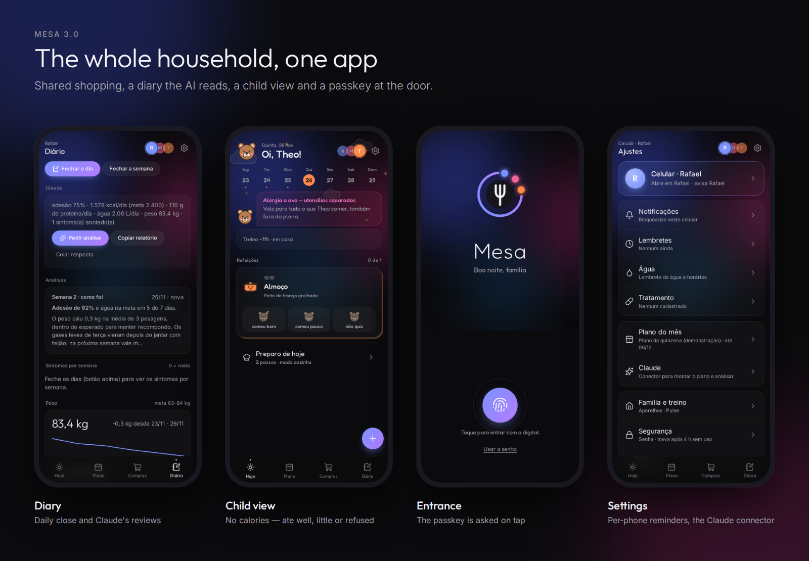
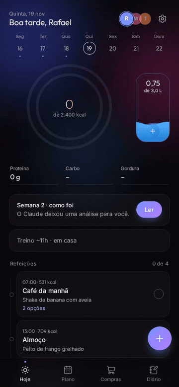
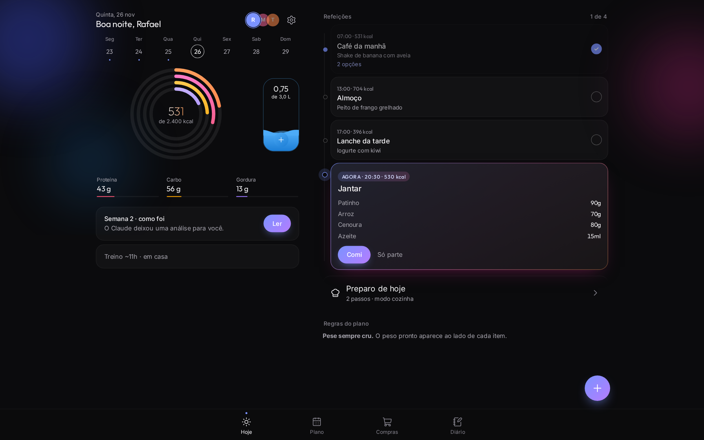
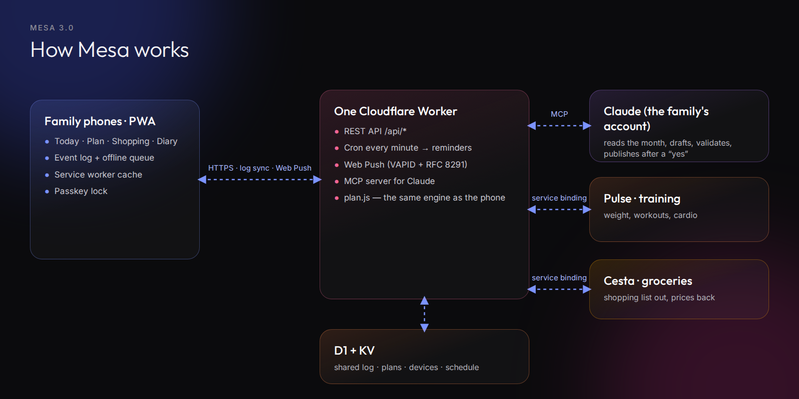
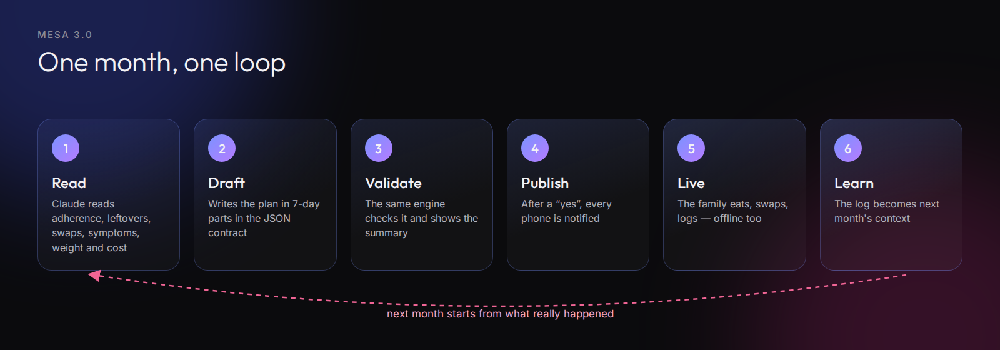

<p align="center"></p>

<p align="center">
  <a href="https://bebernos.github.io/Mesa-Business/"><b>▶ Live demo</b></a> ·
  <a href="README.pt-BR.md">Leia em português</a> ·
  <a href="#screens">Screens</a> ·
  <a href="#how-it-works">Architecture</a> ·
  <a href="SECURITY.md">Security</a> ·
  <a href="docs/case-study.md">Case study</a>
</p>

<p align="center">
  
  
</p>

# Mesa

**Mesa turns a monthly nutrition plan into an app the whole household lives in.** Each phone opens on one person — their
meals, portions, rings and notes, nobody else's. The family shares one shopping list. And next month's plan is written by
the family's own Claude, which reads what actually happened this month through an MCP connector.

Built for a real family and used every day since October 2026: two adults and a child on three different plans, two
phones, one kitchen. **Mesa 3.0** (November 2026) rebuilt the whole interface around a dark "Orbit" look, a new entrance
with the passkey asked on tap, four macro rings and a stricter rule: what belongs to one person stays on that person's screen.

**At a glance:** 22 releases · used daily since Oct 2026 · 3 people on different plans · 0 runtime dependencies ·
44 Worker and engine tests + a 90-check end-to-end run on every pull request

> The live demo runs with a **fictitious family** (Rafael, Marina and Theo) and a plan that always moves with today's
> date. Everything happens in your browser — the server API is simulated and nothing is sent anywhere.

## Screens

<p align="center"></p>
<p align="center"></p>

<p align="center"><br>
<i>Swap today's breakfast for option 2, mark it eaten, log water — the rings, the week and the shopping list follow.</i></p>

<p align="center"><br>
<i>On a computer the day panel and the timeline sit side by side.</i></p>

## What it does

**Today** — one timeline per person: the meal that is due *now* (tap anywhere on it to open the sheet), the rest of the
day, treatment doses and symptoms at their time. Four rings — calories, protein, carbs and fat — plus a water bottle with
a streak. If the plan arrives without carbs or fat, Mesa estimates them from the ingredients (checked against a month
of AI-written values: about 5 g off per meal).

**The meal sheet** — portions in raw and cooked weight, meal options to swap, "ate only part" (tick off what was left) and
"something else": search an offline table of common Brazilian foods and chains, add several items with quantities, or
estimate by type and size. Everything is marked as an estimate so the AI can refine it.

**Plan** — the week as a grid of dots (eaten, skipped, swapped), batch cooking with timers in a large-type kitchen
mode, "why the plan is like this" notes and a printable week.

**Shopping** — one list for the household, by week, by calendar month or for the whole plan, filtered by person. It
follows the options actually chosen, knows what is already in the pantry, syncs live between phones so two people can
split the store, and shows the cost from the family's grocery app.

**Diary** — close the day (energy, mood, symptoms) and the week, food × symptom patterns, guided reintroduction tests,
weight from the training app, and Claude's written reviews, which arrive as a card on Today until read.

**Child view** — no calories: "ate well / a little / refused" per meal, the allergy always in sight, a bear mascot.

**Proactive, not naggy** — reminders at meal time that skip what was eaten, with "Ate it" and "15 min" on the
notification, a water reminder only when behind, and at most two questions a day.

**Entrance** — the plate draws itself, the family's three dots arrive, and the passkey is asked only when you tap.

## How it works

<p align="center"></p>

Mesa is three things that fit together: a **PWA** on every family device, **one Cloudflare Worker** that is API,
scheduler, push sender and MCP server at once, and the **family's own Claude**, which plans the month. A single module —
[`public/js/plan.js`](public/js/plan.js) — understands the plan, and it runs both on the phone and in the Worker.

- **On the device** — plain ES modules render the four tabs from the normalised plan. Every interaction (eaten, swap,
  partial, water, purchase, symptom, dose) is an event written to a local log and an offline queue, pushed in batches and
  pulled incrementally, so phones converge without conflicts the family would notice.
- **At the edge** — the Worker serves the app, the REST API, passkey verification and the MCP endpoint. A cron runs every
  minute: meal reminders from a compact schedule, water nudges, the day's questions. Web Push is implemented from scratch
  (VAPID ES256 + RFC 8291).
- **Data** — D1 holds the shared log (`kind · day · person · k · v`, last write wins) and the plans; KV holds devices,
  subscriptions and the reminder schedule.
- **Integrations** — the training app (Pulse) and the grocery app (Cesta) call Mesa's `Ponte` entrypoint over private
  service bindings: weight, workouts and cardio come in; the shopping list goes out and prices come back.

<p align="center"></p>

**The AI loop** — MCP tools let Claude read the month (adherence, leftovers, swaps, symptoms, tests, weight, water,
training, cost), write the plan in 7-day parts, validate it with the same engine the app uses and publish only after the
user says yes. Every phone is notified the moment it is published.

### Design decisions

| Decision | Why |
|---|---|
| **The plan is a JSON contract** | A new month never needs a release; the AI can't produce what the app doesn't understand. |
| **Same engine on phone and server** | The cron, the AI and the screens agree on what lunch is — always. |
| **MCP, not a paid API** | The family's own Claude does the planning; no API bill and no automation of anyone's account. |
| **Events, not documents** | Partial meals, swaps and purchases are all events → sync, offline and analytics from one model. |
| **Each person, their own screen** | Treatments, tests and notes carry a person; shared texts are filtered so one person's health never shows on another's day. |
| **Estimate, then let the AI correct** | Missing macros and "something else" are estimated on the phone and flagged, so the next plan starts from better numbers. |

## Security

A family password once per device, then a sliding 4-hour session; after that the app locks and the passkey (WebAuthn,
verified on the server) is asked on tap — while notification actions keep working. Writes check `Origin`, the app can be
framed only by the companion training app, and the MCP endpoint lives behind a rotatable secret. Details in
[SECURITY.md](SECURITY.md).

## Engineering highlights

- **No framework, no build step, no runtime dependencies** — plain ES modules, a hand-drawn icon sprite and a design
  system in CSS tokens.
- **Web Push from scratch** — VAPID (ES256) and RFC 8291 `aes128gcm` with WebCrypto, verified in tests by a fake phone
  that decrypts real payloads.
- **One engine, two runtimes** — the plan module runs in the browser and in the Worker, so the server can answer "what's
  for lunch?" for the AI and the cron.
- **Tested like a product** — 44 Worker and engine tests on Node's built-in runner (in-memory KV, D1 on `node:sqlite`)
  and a Playwright run with about 90 checks: passkeys through a virtual authenticator, offline, gestures, large-font
  layout, the child view, desktop. All of it on every pull request, with screenshots kept as artifacts.
- **Images from the product itself** — the screens and diagrams in this README are recorded from the live demo by a
  GitHub Actions workflow ([`scripts/gravar-imagens.mjs`](scripts/gravar-imagens.mjs)).
- **Accessible** — labels on icon buttons, layouts checked with Android's large font, no colour-only states,
  `prefers-reduced-motion` respected.

## Project structure

```
public/v3/        the app: screens (views/), components (ui.js), Orbit skin (v3.css), offline food table (data/)
public/js/        the engine shared with the Worker: plan format, macros, sync log, actions, treatment, diary
public/sw.js      offline shell, notifications and "share a file to Mesa"
src/              the Worker: API, cron, Web Push, WebAuthn, MCP server, water and proactive questions
test/             Node tests for the Worker and engine; Playwright end-to-end run
demo/, scripts/   the in-browser API for the live demo, icon and README image generators
```

**Run it** — `npm ci`, `npm test`; `npm run dev` starts the Worker locally (Wrangler) and
`node test/e2e.v3.mjs` runs the end-to-end suite against it (needs Playwright).

## Tech stack

JavaScript (ES2023, no framework) · HTML/CSS · Service Worker · Web Push (VAPID, RFC 8291) · WebAuthn · Cloudflare
Workers · D1 · KV · Cron Triggers · Model Context Protocol (MCP) · Claude · Playwright · Node.js test runner

## Read more

- [Case study](docs/case-study.md) — the problem, the decisions, what came out, and the 3.0 redesign.
- [Security](SECURITY.md) — threat model and how each layer works.
- [Plan format](docs/PROMPT-DIETA.md) — the JSON contract between the AI and the app (Portuguese).

## The suite

| | |
|---|---|
| [**Lastro**](https://github.com/BeBernos/Lastro-Business) | Family finance hub — cash flow, credit card and investments, encrypted end to end |
| **Mesa** | Family nutrition plan (this repository) |
| [**Pulse**](https://github.com/BeBernos/Pulse-Business) | Strength training with AI-built programs and 2D/3D exercise animations |
| [**Cesta**](https://github.com/BeBernos/Cesta-Business) | Grocery price research, shopping route and receipt audit |

## About

Designed and built by **Bruno Bernos** — product, UX and engineering — working with Claude Code as a pair programmer.
Contact: [github.com/BeBernos](https://github.com/BeBernos).

## License

Copyright © 2026 Bruno Bernos. **All rights reserved.** The source is published for evaluation only; no permission is
granted to use, copy, modify or distribute it. Commercial licenses (including white-label deployments for nutritionists,
clinics and corporate wellness) are available — see [LICENSE](LICENSE) and get in touch.
