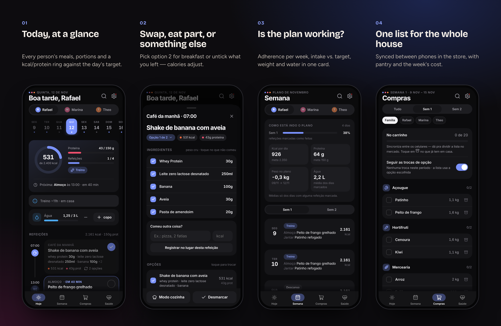
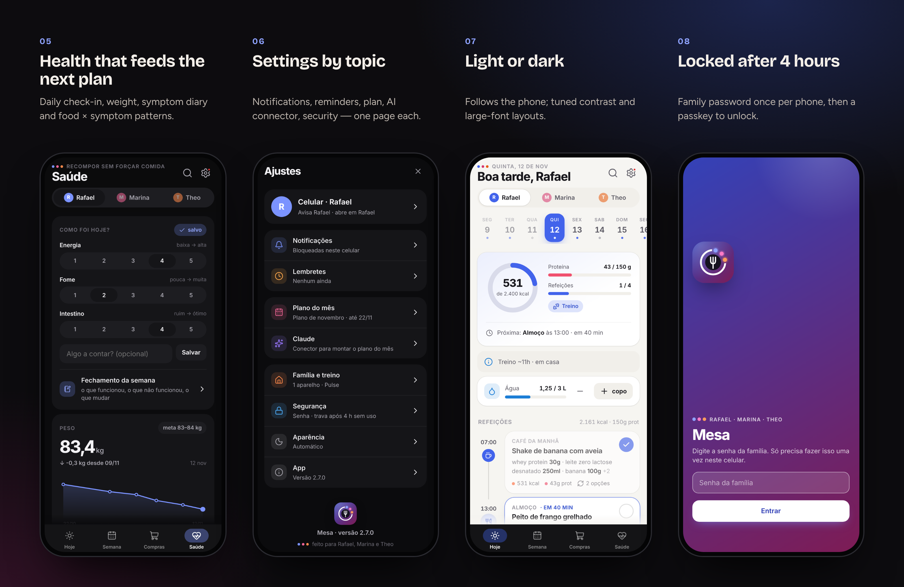
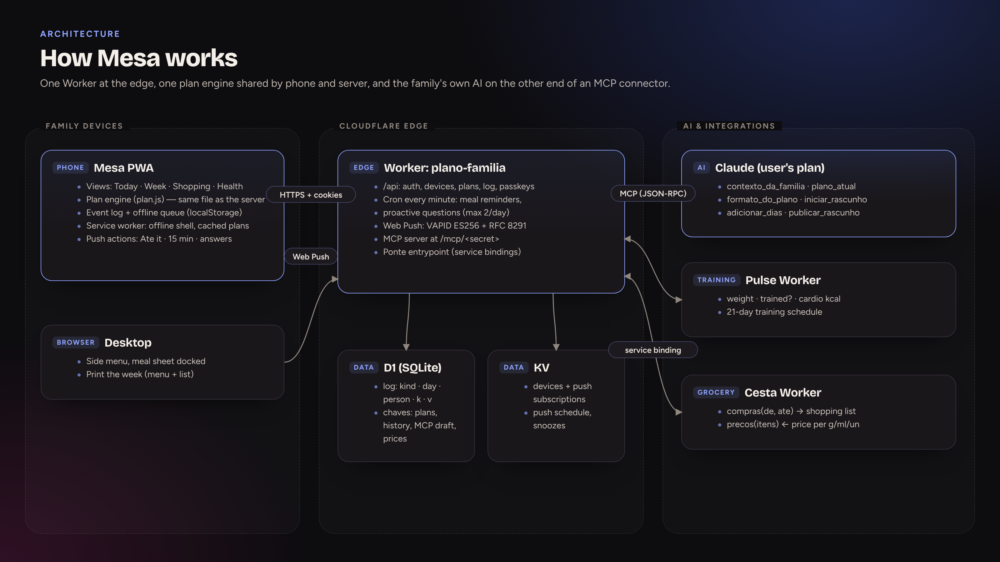
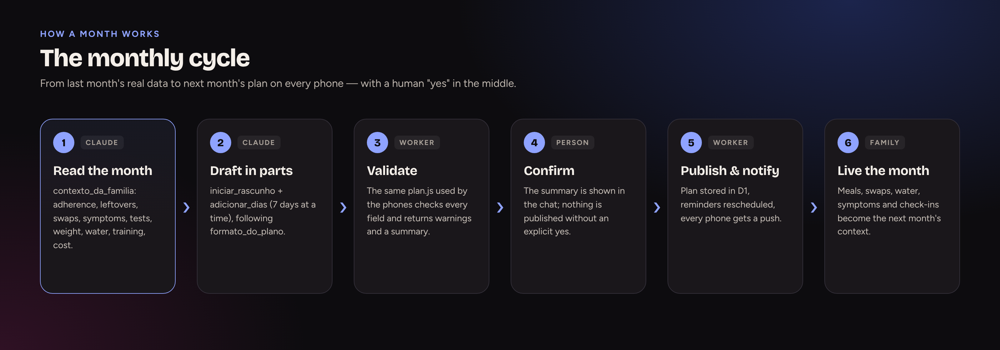

  <a href="https://bebernos.github.io/Mesa-Business/"><b>▶ Live demo</b></a> ·
  <a href="README.pt-BR.md">Leia em português</a> ·
  <a href="#how-it-works">Architecture</a> ·
  <a href="SECURITY.md">Security</a> ·
  <a href="docs/case-study.md">Case study</a>

  
  

# Mesa

**Mesa turns a monthly nutrition plan into a shared app for the whole household — every person sees their own meals and
targets, the family shares one shopping list, and next month's plan is written by an AI (Claude) that reads how this
month actually went.**

It was built for a real family and has been used every day since October 2026: two adults and a child on three
different plans, two phones, one kitchen. Ten releases later it also talks to the family's training app (Pulse) and
grocery app (Cesta).

**At a glance:** 10 releases · used daily since Oct 2026 · 3 people on different plans · 0 runtime dependencies · 27 Worker tests + 2 end-to-end suites on every PR

> The live demo runs with a **fictitious family** (Rafael, Marina and Theo) and a two-week plan that always moves with
> today's date. Everything happens in your browser — the server API is simulated, nothing is sent anywhere.

## What it does

 <i>Swap today's breakfast for option 2, mark it eaten, log water — the ring, the week dashboard and the shopping list follow.</i>

**In detail**
- **Meals** — portions in raw and cooked weight, one tap to mark (with undo), "ate only part" or "something else" with calories
  re-estimated per ingredient, meal options, search, swipe between days, offline queue.
- **Household** — a shopping list per week or plan that follows the chosen options, pantry, batch-cooking totals with timers,
  a printable week, and the weekly cost from the grocery app.
- **Health** — check-in, weekly review, symptom diary with food × symptom patterns, guided reintroduction tests
  (low-FODMAP), and a child view without calories.
- **Proactive** — reminders that skip what was eaten and up to two questions a day, answered from the notification.

## How it works

Mesa is three things that fit together: a **PWA** on every family device, **one Cloudflare Worker** that is API, scheduler,
push sender and MCP server at once, and the **family's own Claude**, which plans the month. A single module —
[`public/js/plan.js`](public/js/plan.js) — understands the plan, and it runs both on the phone and in the Worker.

**On the device** — Plain ES modules render four tabs from the normalised plan. Every interaction (eaten, swap, partial, water, purchase, symptom) is an event written to a local log and an offline queue, pushed in batches and pulled incrementally, so two phones converge without conflicts the family would notice. The service worker caches the shell and the plan, and notification buttons write to the log directly.

**At the edge** — The Worker serves the app, the REST API (`/api/*`), passkey verification and the MCP endpoint. A cron runs every minute: it computes meal reminders from a compact schedule in KV, drops the ones already marked as eaten, and asks the day's proactive questions (two at most, never twice). Web Push is implemented from scratch (VAPID ES256 + RFC 8291).

**Data model** — D1 holds the shared log (`kind · day · person · k · v`, last write wins) and a key-value table for plans, history, the AI's draft and grocery prices; KV holds devices, subscriptions and the reminder schedule. Plans published after Nov 2026 live in D1 for immediate reads; older ones are read from KV.

**The AI loop** — Six MCP tools let Claude read the month (adherence, leftovers, swaps, symptoms, tests, weight, water, training, cost), write a plan in 7-day parts, validate it with the same engine and publish only after the user says yes.

**Integrations** — The training app (Pulse) and the grocery app (Cesta) call Mesa's `Ponte` entrypoint over service bindings: weight, "did you train?", cardio burn and the training schedule come in; the diet's shopping list goes out to Cesta and its prices come back.

### The flow

### Design decisions

| Decision | Why |
|---|---|
| **The plan is a JSON contract** | A new month never needs a release; the AI can't produce what the app doesn't understand. |
| **Same engine on phone and server** | The cron, the AI and the screens agree on what lunch is — always. |
| **MCP, not a paid API** | The user's own Claude does the planning; no API bill and no automation of anyone's account. |
| **Events, not documents** | Partial meals, swaps and purchases are all events → sync, offline and analytics from one model. |

## Security

Login with a family password once per device, then a sliding 4-hour session; after that the app locks and asks for a
**passkey** (WebAuthn, verified on the server) — while notification actions keep working. Writes check `Origin`, the app
can only be framed by the companion training app, and the MCP endpoint lives behind a rotatable secret. Details in
[SECURITY.md](SECURITY.md).

## Engineering highlights

- **No framework, no build step, no runtime dependencies.** Plain ES modules, a hand-drawn icon sprite and a design
  system in CSS tokens.
- **Web Push from scratch** — VAPID (ES256) and RFC 8291 `aes128gcm` encryption with WebCrypto, verified in tests by a
  fake phone that decrypts real payloads.
- **One engine, two runtimes** — the same plan module runs in the browser and in the Worker, so the server can answer
  "what's for lunch?" for the AI and the cron.
- **Tested like a product** — 27 Worker/engine tests on Node's built-in runner (in-memory KV, D1 on `node:sqlite`), plus
  two Playwright end-to-end suites (passkeys with a virtual authenticator, offline, gestures, large-font layout at 280 px,
  desktop). All of it runs on every pull request.
- **Accessible** — screen-reader labels on icon buttons, layouts checked with the Android large-font setting, no colour-only
  states.

## Tech stack

JavaScript (ES2023, no framework) · HTML/CSS · Service Worker · Web Push (VAPID, RFC 8291) · WebAuthn · Cloudflare Workers ·
D1 · KV · Cron Triggers · Model Context Protocol (MCP) · Claude · Playwright · Node.js test runner

## Read more

- [Case study](docs/case-study.md) — the problem, the decisions and what came out of them.
- [Security](SECURITY.md) — threat model and how each layer works.
- [Plan format](docs/PROMPT-DIETA.md) — the JSON contract between the AI and the app (Portuguese).

## The suite

| | |
|---|---|
| [**Lastro**](https://github.com/BeBernos/Lastro-Business) | Family finance hub — cash flow, credit card and investments, encrypted end to end |
| **Mesa** | Family nutrition plan (this repository) |
| [**Pulse**](https://github.com/BeBernos/Pulse-Business) | Strength training with AI-built programs and 2D/3D exercise animations |
| [**Cesta**](https://github.com/BeBernos/Cesta-Business) | Grocery price research, shopping route and receipt audit |

## About

Designed and built by **Bruno Bernos** — product, UX and engineering — working with Claude Code as a pair programmer.
Contact: [github.com/BeBernos](https://github.com/BeBernos).

## License

Copyright © 2026 Bruno Bernos. **All rights reserved.** The source is published for evaluation only; no permission is
granted to use, copy, modify or distribute it. Commercial licenses (including white-label deployments for nutritionists,
clinics and corporate wellness) are available — see [LICENSE](LICENSE) and get in touch.
