
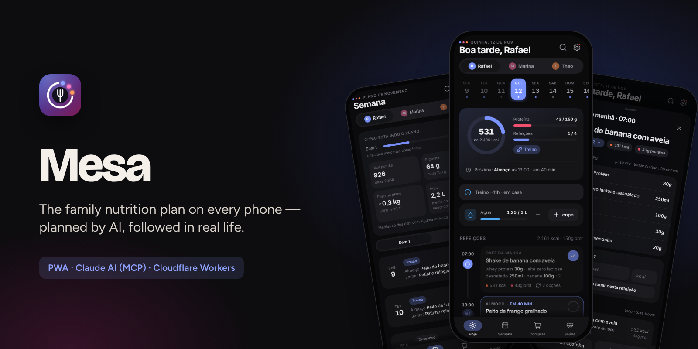

  <a href="https://bebernos.github.io/Mesa-Business/"><b>▶ Live demo</b></a> ·
  <a href="README.pt-BR.md">Leia em português</a> ·
  <a href="#how-it-works">Architecture</a> ·
  <a href="SECURITY.md">Security</a> ·
  <a href="docs/case-study.md">Case study</a>

  
  

# Mesa

**Mesa turns a monthly nutrition plan into a shared app for the whole household — every person sees their own meals and
targets, the family shares one shopping list, and next month's plan is written by an AI (Claude) that reads how this
month actually went.**

It was built for a real family and has been used every day since October 2026: two adults and a child on three
different plans, two phones, one kitchen. Ten releases later it also talks to the family's training app (Pulse) and
grocery app (Cesta).

> The live demo runs with a **fictitious family** (Rafael, Marina and Theo) and a two-week plan that always moves with
> today's date. Everything happens in your browser — the server API is simulated, nothing is sent anywhere.

## What it does

| | | | |
|:---:|:---:|:---:|:---:|
| 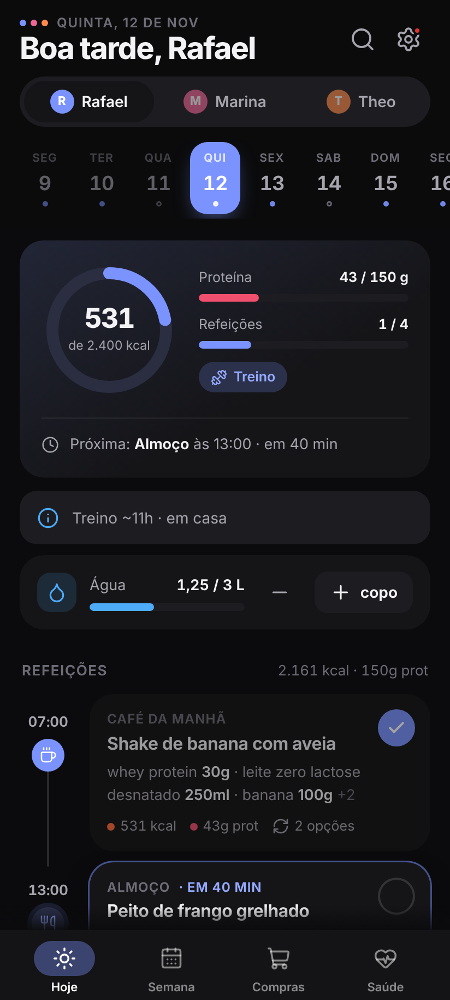 **Today, at a glance** | 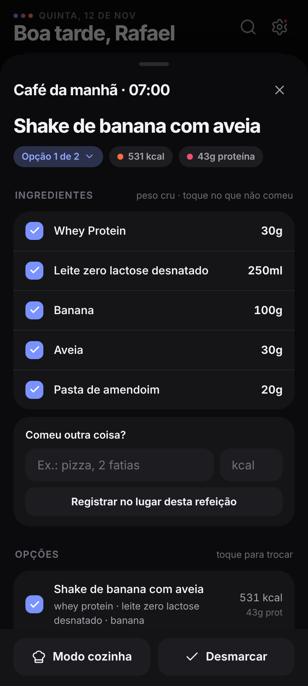 **Meal, options, "ate only part"** | 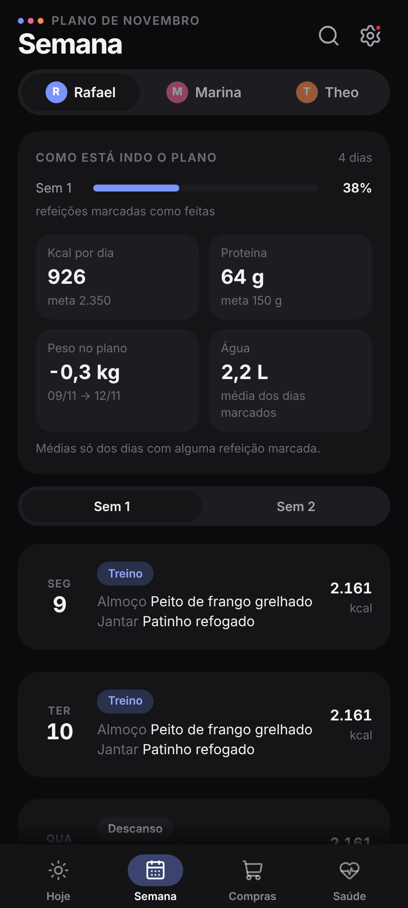 **Is the plan working?** | 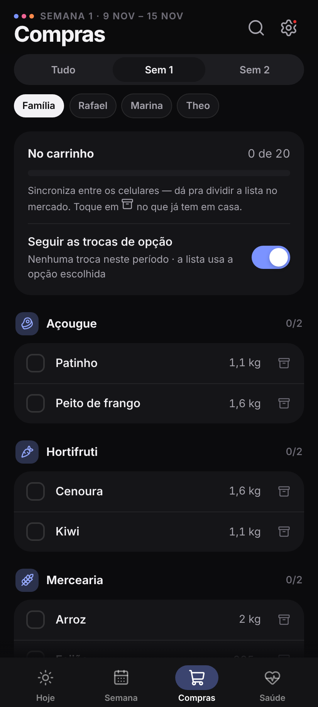 **One list, synced, with cost** |
| 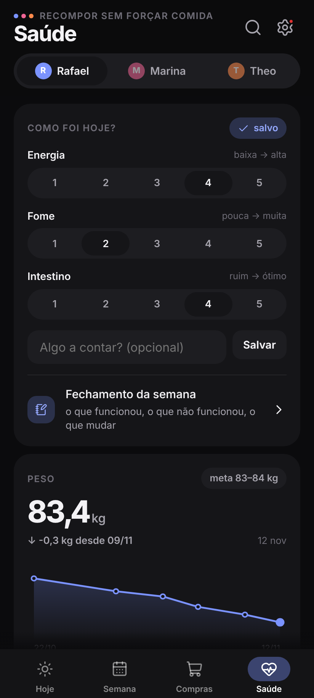 **Check-in, weight, symptoms** | 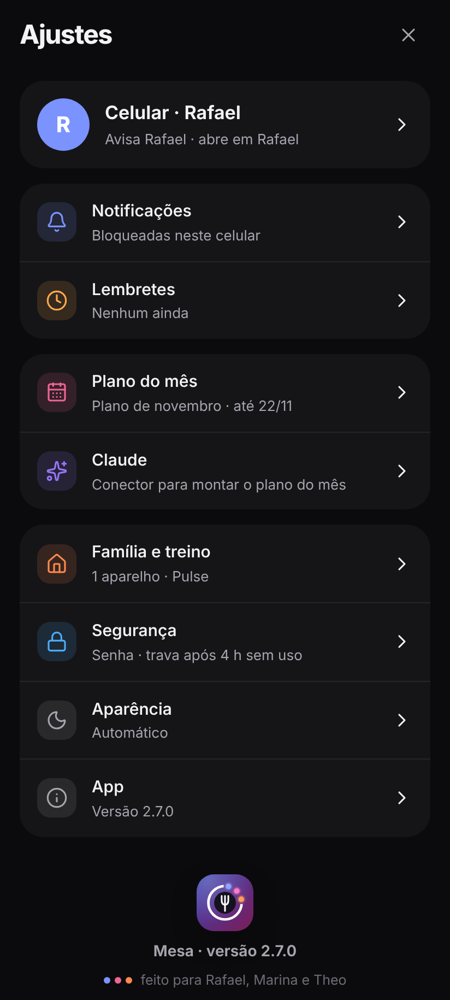 **Settings by topic** | 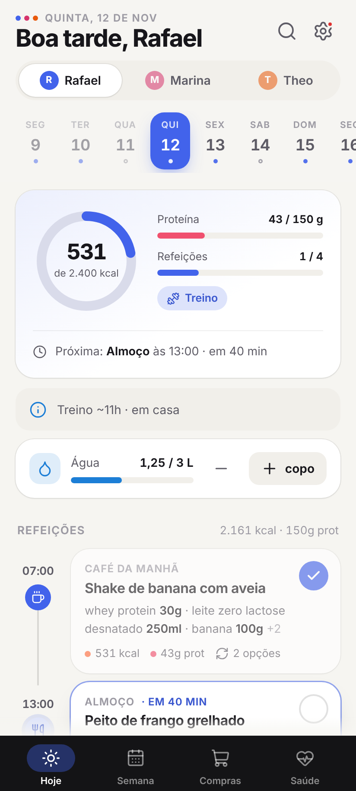 **Light and dark** | 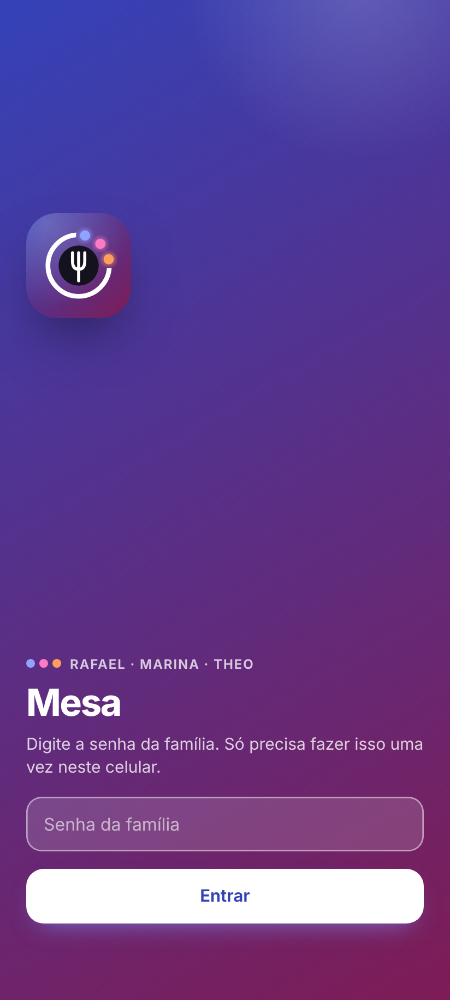 **Family password + passkey** |

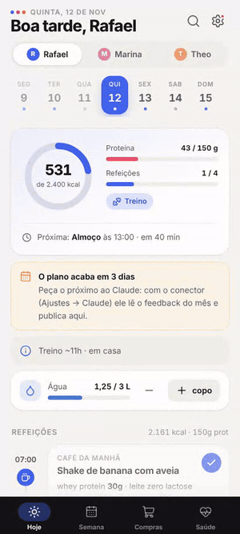 
<i>Swap today's breakfast for option 2, mark it eaten, log water — the ring, the week dashboard and the shopping list follow.</i>

- **Daily use** — a timeline per person with portions in raw and cooked weight, a kcal/protein ring against the day's
  target, one tap to mark a meal (with undo), "ate only part" or "ate something else" with calories re-estimated, water,
  search, swipe between days, offline queue.
- **Household** — one shopping list per week (or the whole plan) split between phones in the store, "already have at
  home", batch-cooking totals with timers, a printable weekly menu, and the weekly **cost** from the grocery app's prices.
- **Health** — daily check-in (energy, hunger, digestion), weekly review, symptom diary with a **food × symptom** pattern
  finder, guided food-reintroduction tests (low-FODMAP) with reminders and pass/fail history, a child view ("ate well /
  little / refused") instead of calories.
- **A proactive app** — reminders at meal time that skip meals already eaten, and up to two questions a day ("Any
  reaction to the garlic?") answered straight from the notification.
- **AI where it adds judgment** — Claude reads the month (adherence, leftovers, swaps, symptoms, weight, training,
  cost) through an **MCP connector**, drafts the next plan in parts, validates it, shows a summary and publishes only after
  the user confirms. No paid API: it runs on the user's own Claude subscription.

## How it works

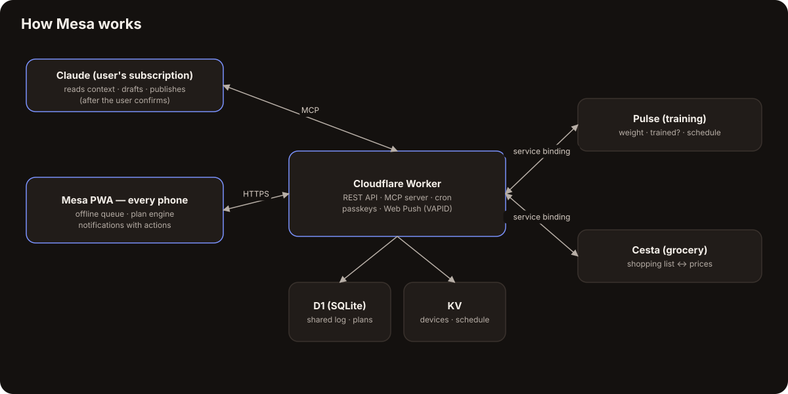

The unusual part: **the plan is a contract, not a screen.** The AI writes a documented JSON format
([`docs/PROMPT-DIETA.md`](docs/PROMPT-DIETA.md), example in [`docs/exemplo-plano.json`](docs/exemplo-plano.json)); one
module ([`public/js/plan.js`](public/js/plan.js)) validates and interprets it **on the phone and on the server alike** —
meal options, partial-meal estimates, the shopping list, batch totals, cost, the food × symptom analysis. The app never
hard-codes a diet: a new month is a new JSON, and the family's phones are notified the moment it is published.

Every interaction is an event in a shared log (meal eaten, item bought, weight, symptom…) stored in Cloudflare D1 with
last-write-wins sync and an offline queue on each phone. Two other Workers (training and grocery apps) talk to Mesa over
private service bindings — no public endpoints.

## Security

Login with a family password once per device, then a sliding 4-hour session; after that the app locks and asks for a
**passkey** (WebAuthn, verified on the server) — while notification actions keep working. Writes check `Origin`, the app
can only be framed by the companion training app, and the MCP endpoint lives behind a rotatable secret. Details in
[SECURITY.md](SECURITY.md).

## Engineering highlights

- **No framework, no build step, no runtime dependencies.** Plain ES modules, a hand-drawn icon sprite and a design
  system in CSS tokens.
- **Web Push from scratch** — VAPID (ES256) and RFC 8291 `aes128gcm` encryption with WebCrypto, verified in tests by a
  fake phone that decrypts real payloads.
- **One engine, two runtimes** — the same plan module runs in the browser and in the Worker, so the server can answer
  "what's for lunch?" for the AI and the cron.
- **Tested like a product** — 27 Worker/engine tests on Node's built-in runner (in-memory KV, D1 on `node:sqlite`), plus
  two Playwright end-to-end suites (passkeys with a virtual authenticator, offline, gestures, large-font layout at 280 px,
  desktop). All of it runs on every pull request.
- **Accessible** — screen-reader labels on icon buttons, layouts checked with the Android large-font setting, no colour-only
  states.

## Tech stack

JavaScript (ES2023, no framework) · HTML/CSS · Service Worker · Web Push (VAPID, RFC 8291) · WebAuthn · Cloudflare Workers ·
D1 · KV · Cron Triggers · Model Context Protocol (MCP) · Claude · Playwright · Node.js test runner

## Read more

- [Case study](docs/case-study.md) — the problem, the decisions and what came out of them.
- [Security](SECURITY.md) — threat model and how each layer works.
- [Plan format](docs/PROMPT-DIETA.md) — the JSON contract between the AI and the app (Portuguese).

## The suite

| | |
|---|---|
| [**Lastro**](https://github.com/BeBernos/Lastro-Business) | Family finance hub — cash flow, credit card and investments, encrypted end to end |
| **Mesa** | Family nutrition plan (this repository) |
| [**Pulse**](https://github.com/BeBernos/Pulse-Business) | Strength training with AI-built programs and 2D/3D exercise animations |
| [**Cesta**](https://github.com/BeBernos/Cesta-Business) | Grocery price research, shopping route and receipt audit |

## About

Designed and built by **Bruno Bernos** — product, UX and engineering — working with Claude Code as a pair programmer.
Contact: [github.com/BeBernos](https://github.com/BeBernos).

## License

Copyright © 2026 Bruno Bernos. **All rights reserved.** The source is published for evaluation only; no permission is
granted to use, copy, modify or distribute it. Commercial licenses (including white-label deployments for nutritionists,
clinics and corporate wellness) are available — see [LICENSE](LICENSE) and get in touch.
