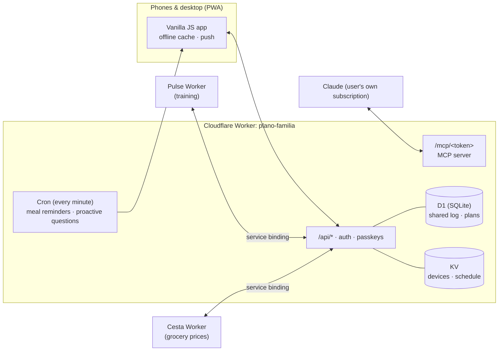

<p align="center"></p>

<h1 align="center">Mesa</h1>
<p align="center"><b>The family nutrition plan, on every phone — planned by AI, followed in real life.</b></p>

<p align="center">
  <a href="README.pt-BR.md">🇧🇷 Leia em português</a> ·
  <a href="#demo">Demo</a> ·
  <a href="#architecture">Architecture</a> ·
  <a href="#commercial-use">Commercial use</a>
</p>

<p align="center">
  
  
  
  
  
</p>

---

Mesa turns a monthly nutrition plan into a shared, living app for the whole household. Each person sees their own
meals, portions and targets; the family sees one shopping list; and the plan for next month is written by an AI
assistant that reads how the current month actually went — what was eaten, skipped, swapped, how people felt.

> The interface is in Brazilian Portuguese. All data in this repository and in the images is fictitious
> (a demo family: Rafael, Marina and Theo).

## Demo

<p align="center"></p>

| Today | Meal & options | Plan dashboard | Shopping |
|---|---|---|---|
|  |  |  |  |

| Health & feedback | Settings | Dark mode | Login |
|---|---|---|---|
|  |  |  |  |

**Desktop** — the meal sheet docks next to the timeline:


## What it does

**Daily use**
- Personal timeline per person: meals, portions (raw and cooked weight), kcal/protein ring against the day's target.
- One tap to mark a meal as eaten (with undo); mark only *part* of a meal or log "ate something else" — calories adjust.
- Meal options: swap today's breakfast for option 2 or 3; totals and the shopping list follow the swap.
- Water tracking, search ("when is there chicken this month?"), swipe between days, pull to refresh, offline queue.
- Child view: "ate well / little / refused" instead of calories, allergies always visible.

**Planning & household**
- Shared shopping list per week or whole plan, synced between phones in the store; "already have at home" pantry.
- Batch cooking: weekly totals (raw and cooked) and timers in kitchen mode; printable weekly menu + list.
- Plan dashboard: adherence per week, average intake vs. target, weight trend, hydration.
- Cost of the diet per week, from the prices captured in the companion grocery app ([Cesta](https://github.com/BeBernos/Cesta-Business)).

**Health**
- Daily check-in (energy, hunger, digestion) and weekly review — the input for next month's plan.
- Symptom diary with a **food × symptom** pattern finder.
- Guided food reintroduction tests (e.g. low-FODMAP): reminders on dose day, follow-up questions, pass/fail per food, history.
- Proactive notifications that ask instead of nag (max. 2/day, answerable from the notification itself).

**AI-planned, without a paid API**
- An **MCP connector** (Model Context Protocol) lets the user's own Claude subscription read the family context and publish
  next month's plan: draft in parts, validate, show a summary, publish only after confirmation.
- The plan is a documented JSON contract ([`docs/PROMPT-DIETA.md`](docs/PROMPT-DIETA.md), example in
  [`docs/exemplo-plano.json`](docs/exemplo-plano.json)), validated on both the server and the device.

**Integrations**
- [Pulse](https://github.com/BeBernos/Pulse-Business) (training app): official body weight, "did you train today?", cardio burn and the
  training schedule (training vs. rest day, pre/post-workout meal times) over a private Worker-to-Worker binding.
- [Cesta](https://github.com/BeBernos/Cesta-Business) (grocery prices): pulls the diet's shopping list and sends prices back.

## Architecture



- **Frontend:** a PWA in plain JavaScript modules — no framework, no build step, no runtime dependencies. Service worker with
  offline shell, cached plans and Web Push (notification actions: "Ate it", "15 min", answers to questions).
- **Backend:** one Cloudflare Worker — static assets, REST API, cron and the MCP server. **D1** stores the shared event log
  (meals, shopping, weight, symptoms, tests…) with last-write-wins sync; **KV** stores devices and the push schedule.
- **Web Push from scratch:** VAPID (ES256) and RFC 8291 `aes128gcm` encryption implemented with WebCrypto.
- **Security:** device cookie + sliding 4-hour session, lock screen with **passkeys** (WebAuthn, verified server-side),
  `Origin` checks on writes, `frame-ancestors` restricted to the companion app, MCP endpoint behind a rotatable secret.
- **Plan engine:** one module ([`public/js/plan.js`](public/js/plan.js)) shared by browser and Worker: validation, meal
  options (including inferring options from rotation), partial-meal estimates, shopping list, batch totals, cost, analytics.

## Quality

- `npm test` — Node's built-in test runner against the real Worker code (in-memory KV, `node:sqlite` D1, a fake phone
  that decrypts real Web Push payloads, a WebAuthn signature check).
- Two end-to-end suites with Playwright against `wrangler dev` (virtual authenticator for passkeys, offline mode, swipe
  gestures, large-font layout at 280 px, desktop layout).
- Both run on every pull request ([`.github/workflows/testes.yml`](.github/workflows/testes.yml)).

## Run it locally

```bash
npm install
echo "APP_PASSWORD=choose-a-password" > .dev.vars
npm run dev                         # http://localhost:8787
npm test                            # unit + Worker tests
SHOTS=shots node test/e2e.mesa.mjs  # end-to-end (needs Playwright and a fresh wrangler state)
```

Deploying needs a Cloudflare account (free plan): `wrangler deploy` creates the Worker; KV and D1 are declared in
[`wrangler.jsonc`](wrangler.jsonc).

## Commercial use

This repository is **source-available, not open source**: you may read and evaluate the code, but production or commercial
use requires a license. Licenses are available for **white-label deployments** (nutritionists, clinics, meal-plan services,
corporate wellness) and for custom development. See [LICENSE](LICENSE) and get in touch through
[github.com/BeBernos](https://github.com/BeBernos).

## Part of a suite

| | |
|---|---|
| **Mesa** | Family nutrition plan (this repository) |
| [**Pulse**](https://github.com/BeBernos/Pulse-Business) | Strength training with AI-built programs and 2D/3D exercise animations |
| [**Cesta**](https://github.com/BeBernos/Cesta-Business) | Grocery price research and comparison across stores |
