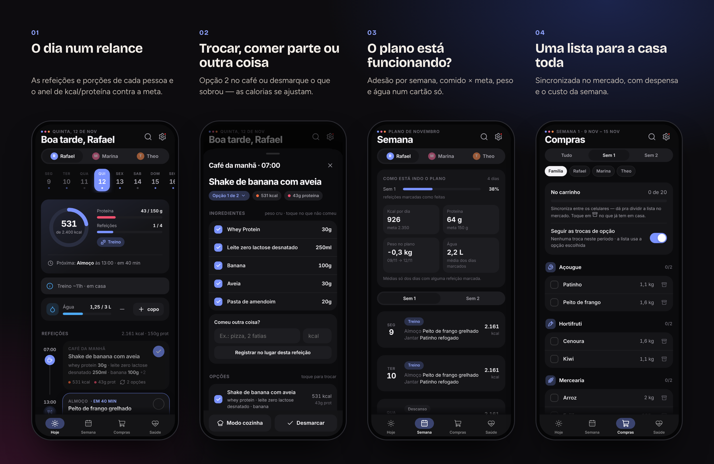
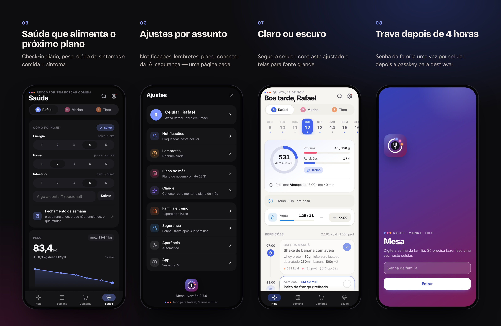
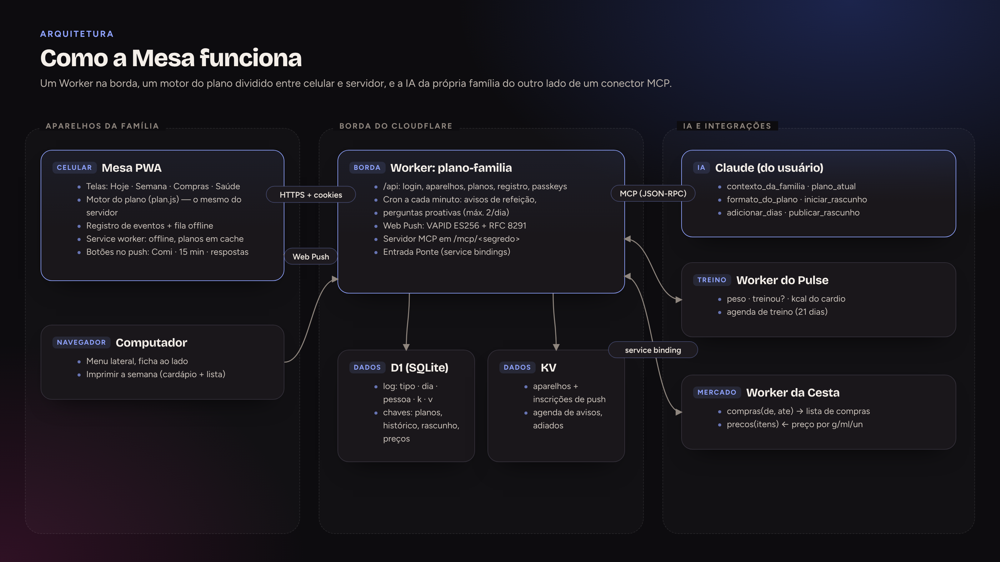
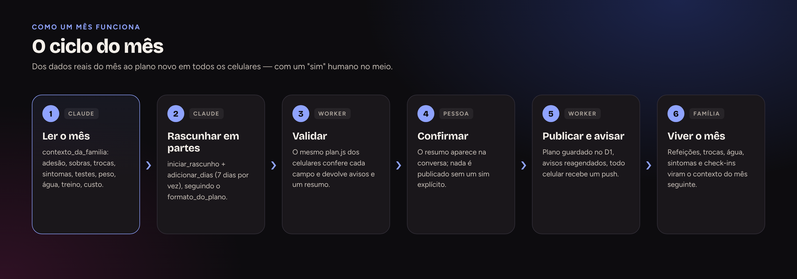

  <a href="https://bebernos.github.io/Mesa-Business/"><b>▶ Demonstração ao vivo</b></a> ·
  <a href="README.md">Read in English</a> ·
  <a href="#como-funciona">Arquitetura</a> ·
  <a href="SECURITY.md">Segurança</a> ·
  <a href="docs/case-study.pt-BR.md">Estudo de caso</a>

  
  

# Mesa

**A Mesa transforma o plano alimentar do mês num app compartilhado pela casa — cada pessoa vê as próprias refeições e
metas, a família divide uma lista de compras só, e o plano do mês seguinte é escrito por uma IA (o Claude) que lê como o
mês realmente foi.**

Foi feita para uma família de verdade e é usada todo dia desde outubro de 2026: dois adultos e uma criança em três
planos diferentes, dois celulares, uma cozinha. Dez versões depois, ela também conversa com o app de treino da família
(Pulse) e com o de mercado (Cesta).

**Em números:** 10 versões · uso diário desde out/2026 · 3 pessoas com planos diferentes · 0 dependências · 27 testes do Worker + 2 suítes de ponta a ponta em todo PR

> A demonstração ao vivo usa uma **família fictícia** (Rafael, Marina e Theo) e um plano de duas semanas que sempre
> acompanha a data de hoje. Tudo acontece no seu navegador — a API do servidor é simulada, nada é enviado.

## O que faz

 <i>Troca o café de hoje pela opção 2, marca como comido, anota a água — o anel, o painel da semana e a lista de compras acompanham.</i>

**Em detalhe**
- **Refeições** — porções em peso cru e pronto, um toque para marcar (com desfazer), "comi só parte" ou "outra coisa" com as
  calorias reestimadas por ingrediente, opções de refeição, busca, deslizar entre dias, fila offline.
- **Casa** — lista de compras por semana ou do plano que segue as opções escolhidas, despensa, totais do preparo em lote com
  temporizadores, a semana para imprimir e o custo da semana vindo do app de mercado.
- **Saúde** — check-in, fechamento da semana, diário de sintomas com comida × sintoma, testes de reintrodução guiados (FODMAP)
  e a visão da criança sem calorias.
- **Proativa** — avisos que pulam o que já foi comido e até duas perguntas por dia, respondidas na própria notificação.

## Como funciona

A Mesa são três peças que se encaixam: um **PWA** em cada aparelho da família, **um Worker do Cloudflare** que é ao mesmo tempo
API, agendador, envio de push e servidor MCP, e o **Claude da própria família**, que planeja o mês. Um módulo só —
[`public/js/plan.js`](public/js/plan.js) — entende o plano, e ele roda no celular e no Worker.

**No aparelho** — Módulos ES puros desenham quatro abas a partir do plano normalizado. Cada interação (comi, troca, parte, água, compra, sintoma) é um evento gravado num registro local e numa fila offline, enviado em lotes e baixado aos poucos, então dois celulares convergem sem conflitos que a família perceba. O service worker guarda o app e o plano, e os botões da notificação gravam direto no registro.

**Na borda** — O Worker serve o app, a API REST (`/api/*`), a conferência das passkeys e o endereço MCP. Um cron roda a cada minuto: calcula os avisos de refeição a partir de uma agenda compacta no KV, tira os que já foram marcados como comidos e faz as perguntas proativas do dia (no máximo duas, nunca repetidas). O Web Push é feito do zero (VAPID ES256 + RFC 8291).

**Modelo de dados** — O D1 guarda o registro compartilhado (`tipo · dia · pessoa · k · v`, vence a última gravação) e uma tabela chave-valor para planos, histórico, rascunho da IA e preços do mercado; o KV guarda aparelhos, inscrições e a agenda dos avisos. Planos publicados a partir de nov/2026 ficam no D1 para leitura imediata; os antigos são lidos do KV.

**O ciclo com a IA** — Seis ferramentas MCP deixam o Claude ler o mês (adesão, sobras, trocas, sintomas, testes, peso, água, treino, custo), escrever o plano em partes de 7 dias, validar com o mesmo motor e publicar só depois do sim do usuário.

**Integrações** — O app de treino (Pulse) e o de mercado (Cesta) chamam a entrada `Ponte` da Mesa por service bindings: entram peso, "treinou?", gasto do cardio e a agenda de treino; sai a lista de compras da dieta para a Cesta e voltam os preços.

### O fluxo

### Decisões de projeto

| Decisão | Por quê |
|---|---|
| **O plano é um contrato JSON** | Mês novo nunca exige versão nova; a IA não consegue produzir o que o app não entende. |
| **O mesmo motor no celular e no servidor** | O cron, a IA e as telas concordam sobre o que é o almoço — sempre. |
| **MCP, não API paga** | O Claude do próprio usuário planeja; sem conta de API e sem automatizar a conta de ninguém. |
| **Eventos, não documentos** | Refeição parcial, troca e compra são eventos → sincronização, offline e análises de um modelo só. |

## Segurança

Senha da família uma vez por aparelho, depois uma sessão de 4 horas que se renova; passado isso, o app trava e pede a
**passkey** (WebAuthn conferido no servidor) — e os botões das notificações continuam funcionando. Gravações conferem a
`Origin`, o app só pode ser aberto dentro do app de treino parceiro, e o conector MCP fica atrás de um segredo que pode ser
trocado. Detalhes em [SECURITY.md](SECURITY.md).

## Destaques de engenharia

- **Sem framework, sem build, sem dependências.** Módulos ES puros, ícones desenhados num sprite próprio e um sistema
  visual em tokens de CSS.
- **Web Push do zero** — VAPID (ES256) e criptografia `aes128gcm` (RFC 8291) com WebCrypto, conferidos nos testes por um
  celular de mentira que decifra as mensagens de verdade.
- **Um motor, dois ambientes** — o mesmo módulo do plano roda no navegador e no Worker, então o servidor sabe responder "o
  que tem no almoço?" para a IA e para o cron.
- **Testado como produto** — 27 testes do Worker e do motor no test runner do Node (KV em memória, D1 sobre `node:sqlite`)
  e duas suítes de ponta a ponta com Playwright (passkey com autenticador virtual, offline, gestos, fonte grande a 280 px,
  computador). Tudo roda a cada pull request.
- **Acessível** — rótulos para leitor de tela nos botões só com ícone, telas conferidas com a fonte grande do Android,
  nenhum estado só por cor.

## Tecnologias

JavaScript (ES2023, sem framework) · HTML/CSS · Service Worker · Web Push (VAPID, RFC 8291) · WebAuthn · Cloudflare Workers ·
D1 · KV · Cron Triggers · Model Context Protocol (MCP) · Claude · Playwright · test runner do Node

## Para ler mais

- [Estudo de caso](docs/case-study.pt-BR.md) — o problema, as decisões e o que saiu delas.
- [Segurança](SECURITY.md) — modelo de ameaças e como cada camada funciona.
- [Formato do plano](docs/PROMPT-DIETA.md) — o contrato JSON entre a IA e o app.

## O conjunto

| | |
|---|---|
| [**Lastro**](https://github.com/BeBernos/Lastro-Business) | Finanças da família — caixa, cartão e investimentos, com criptografia de ponta a ponta |
| **Mesa** | Plano alimentar da família (este repositório) |
| [**Pulse**](https://github.com/BeBernos/Pulse-Business) | Treino de força com programas montados por IA e animações 2D/3D dos exercícios |
| [**Cesta**](https://github.com/BeBernos/Cesta-Business) | Pesquisa de preços de mercado, rota de compra e conferência da nota |

## Sobre

Concebido e construído por **Bruno Bernos** — produto, UX e engenharia — com o Claude Code como par de programação.
Contato: [github.com/BeBernos](https://github.com/BeBernos).

## Licença

Copyright © 2026 Bruno Bernos. **Todos os direitos reservados.** O código está publicado só para avaliação; não há
permissão para usar, copiar, modificar ou distribuir. Há licenças comerciais (inclusive white-label para nutricionistas,
clínicas e bem-estar corporativo) — veja a [LICENSE](LICENSE) e fale comigo.
