
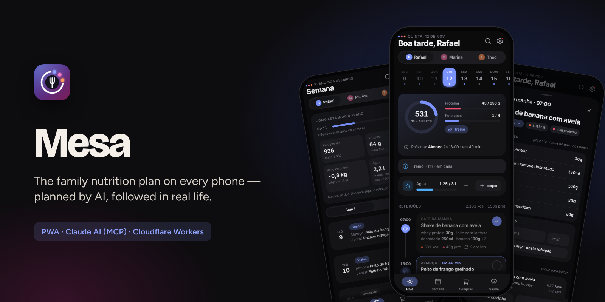

  <a href="https://bebernos.github.io/Mesa-Business/"><b>▶ Demonstração ao vivo</b></a> ·
  <a href="README.md">Read in English</a> ·
  <a href="#como-funciona">Arquitetura</a> ·
  <a href="SECURITY.md">Segurança</a> ·
  <a href="docs/case-study.pt-BR.md">Estudo de caso</a>

  
  

# Mesa

**A Mesa transforma o plano alimentar do mês num app compartilhado pela casa — cada pessoa vê as próprias refeições e
metas, a família divide uma lista de compras só, e o plano do mês seguinte é escrito por uma IA (o Claude) que lê como o
mês realmente foi.**

Foi feita para uma família de verdade e é usada todo dia desde outubro de 2026: dois adultos e uma criança em três
planos diferentes, dois celulares, uma cozinha. Dez versões depois, ela também conversa com o app de treino da família
(Pulse) e com o de mercado (Cesta).

> A demonstração ao vivo usa uma **família fictícia** (Rafael, Marina e Theo) e um plano de duas semanas que sempre
> acompanha a data de hoje. Tudo acontece no seu navegador — a API do servidor é simulada, nada é enviado.

## O que faz

| | | | |
|:---:|:---:|:---:|:---:|
| 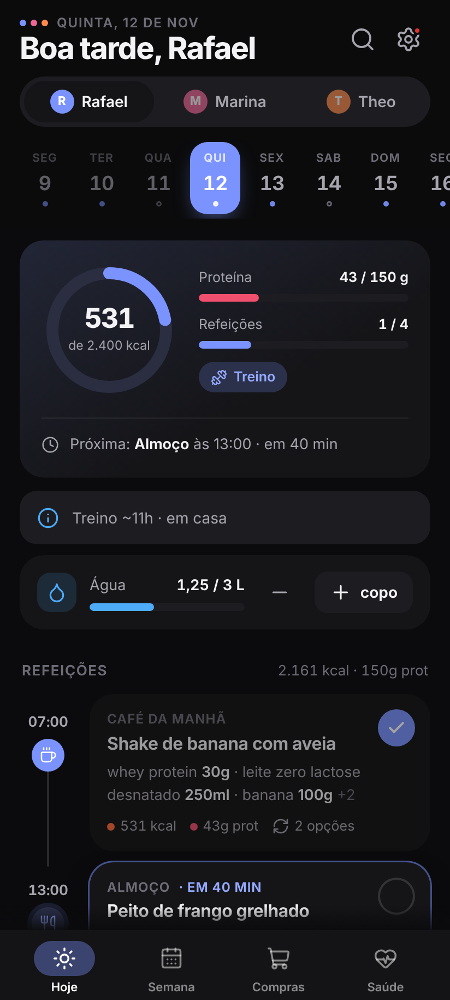 **O dia num relance** | 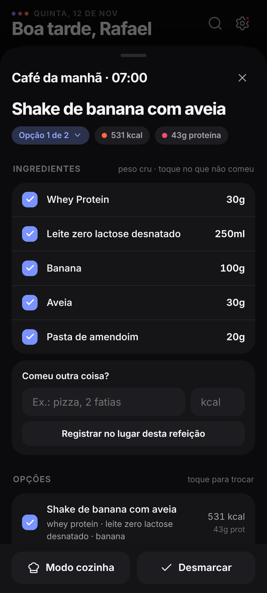 **Refeição, opções, "comi só parte"** | 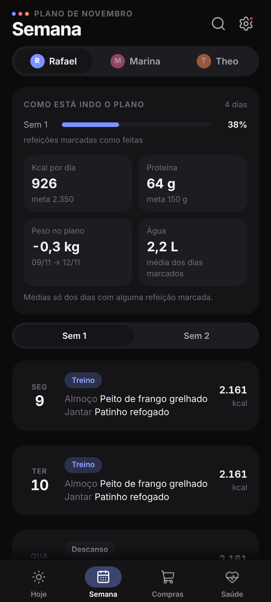 **O plano está funcionando?** | 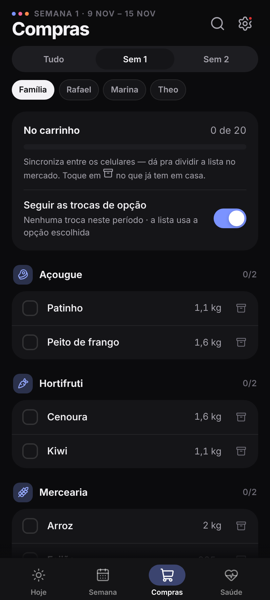 **Uma lista, sincronizada, com custo** |
| 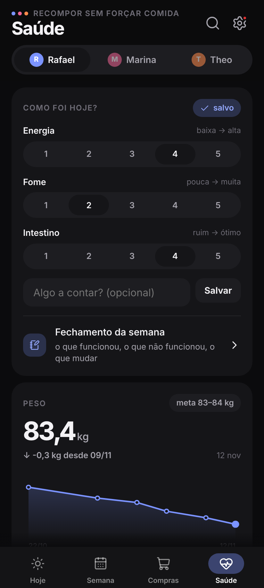 **Check-in, peso, sintomas** | 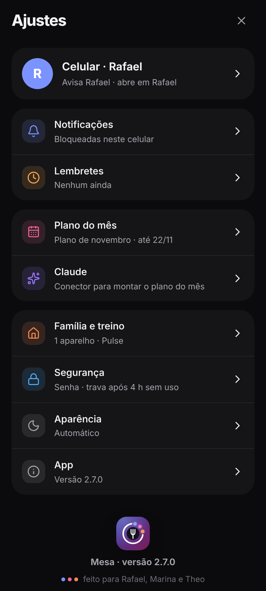 **Ajustes por assunto** | 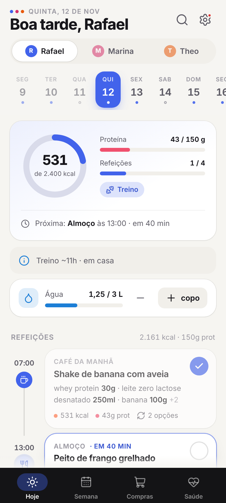 **Claro e escuro** | 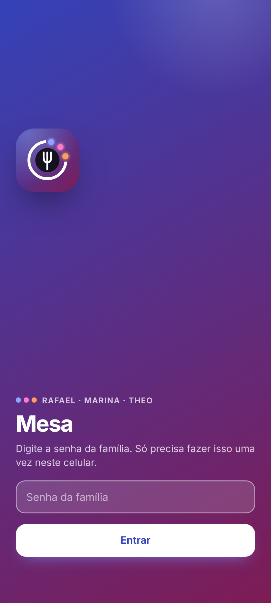 **Senha da família + passkey** |

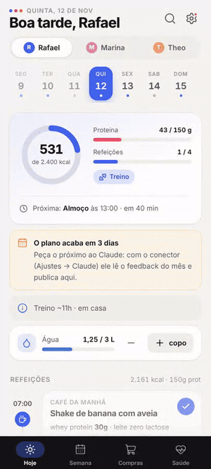 
<i>Troca o café de hoje pela opção 2, marca como comido, anota a água — o anel, o painel da semana e a lista de compras acompanham.</i>

- **No dia a dia** — linha do tempo por pessoa com porções em peso cru e pronto, anel de kcal/proteína contra a meta do
  dia, um toque para marcar a refeição (com desfazer), "comi só parte" ou "comi outra coisa" com as calorias reestimadas,
  água, busca, deslizar entre dias, fila offline.
- **Na casa** — uma lista de compras por semana (ou do plano inteiro) dividida entre os celulares no mercado, "já tenho em
  casa", totais do preparo em lote com temporizadores, cardápio da semana para imprimir e o **custo** da semana com os
  preços do app de mercado.
- **Saúde** — check-in diário (energia, fome, intestino), fechamento da semana, diário de sintomas com o cruzamento
  **comida × sintoma**, testes de reintrodução guiados (FODMAP) com lembretes e histórico, e a visão da criança ("comeu bem
  / pouco / recusou") no lugar das calorias.
- **Um app proativo** — avisos na hora da refeição que pulam o que já foi comido, e até duas perguntas por dia ("Alguma
  reação ao alho?") respondidas na própria notificação.
- **IA onde ela acrescenta julgamento** — o Claude lê o mês (adesão, sobras, trocas, sintomas, peso, treino, custo) por um
  **conector MCP**, rascunha o próximo plano em partes, valida, mostra um resumo e só publica depois que o usuário confirma.
  Sem API paga: roda na assinatura do Claude do próprio usuário.

## Como funciona

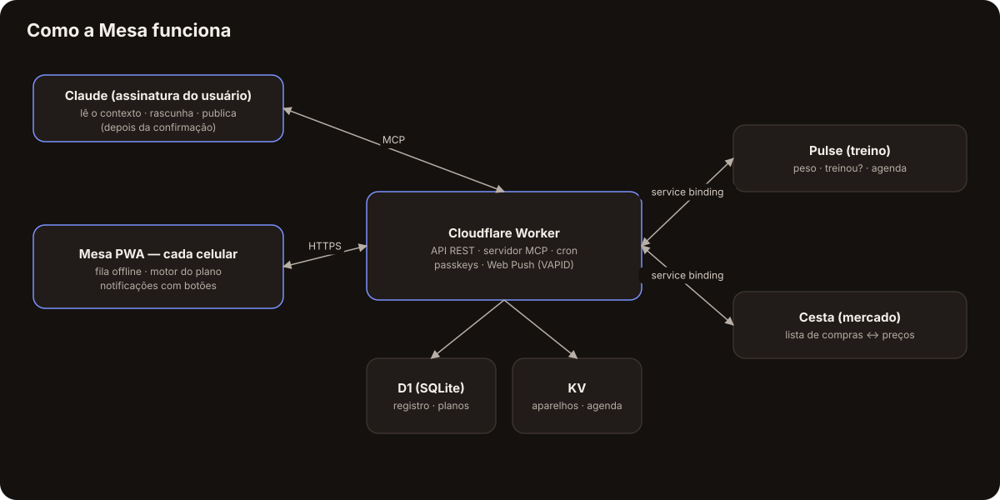

O diferente: **o plano é um contrato, não uma tela.** A IA escreve num formato JSON documentado
([`docs/PROMPT-DIETA.md`](docs/PROMPT-DIETA.md), exemplo em [`docs/exemplo-plano.json`](docs/exemplo-plano.json)); um
módulo só ([`public/js/plan.js`](public/js/plan.js)) valida e interpreta **no celular e no servidor** — opções de
refeição, estimativa de refeição parcial, lista de compras, lote, custo, a análise comida × sintoma. O app nunca tem uma
dieta fixa no código: um mês novo é um JSON novo, e os celulares da família são avisados na hora em que ele é publicado.

Cada interação é um evento num registro compartilhado (refeição comida, item comprado, peso, sintoma…) guardado no
Cloudflare D1, com sincronização "vence a última gravação" e fila offline em cada celular. Os outros dois Workers (treino e
mercado) falam com a Mesa por ligações privadas entre Workers — nada de endereço público.

## Segurança

Senha da família uma vez por aparelho, depois uma sessão de 4 horas que se renova; passado isso, o app trava e pede a
**passkey** (WebAuthn conferido no servidor) — e os botões das notificações continuam funcionando. Gravações conferem a
`Origin`, o app só pode ser aberto dentro do app de treino parceiro, e o conector MCP fica atrás de um segredo que pode ser
trocado. Detalhes em [SECURITY.md](SECURITY.md).

## Destaques de engenharia

- **Sem framework, sem build, sem dependências.** Módulos ES puros, ícones desenhados num sprite próprio e um sistema
  visual em tokens de CSS.
- **Web Push do zero** — VAPID (ES256) e criptografia `aes128gcm` (RFC 8291) com WebCrypto, conferidos nos testes por um
  celular de mentira que decifra as mensagens de verdade.
- **Um motor, dois ambientes** — o mesmo módulo do plano roda no navegador e no Worker, então o servidor sabe responder "o
  que tem no almoço?" para a IA e para o cron.
- **Testado como produto** — 27 testes do Worker e do motor no test runner do Node (KV em memória, D1 sobre `node:sqlite`)
  e duas suítes de ponta a ponta com Playwright (passkey com autenticador virtual, offline, gestos, fonte grande a 280 px,
  computador). Tudo roda a cada pull request.
- **Acessível** — rótulos para leitor de tela nos botões só com ícone, telas conferidas com a fonte grande do Android,
  nenhum estado só por cor.

## Tecnologias

JavaScript (ES2023, sem framework) · HTML/CSS · Service Worker · Web Push (VAPID, RFC 8291) · WebAuthn · Cloudflare Workers ·
D1 · KV · Cron Triggers · Model Context Protocol (MCP) · Claude · Playwright · test runner do Node

## Para ler mais

- [Estudo de caso](docs/case-study.pt-BR.md) — o problema, as decisões e o que saiu delas.
- [Segurança](SECURITY.md) — modelo de ameaças e como cada camada funciona.
- [Formato do plano](docs/PROMPT-DIETA.md) — o contrato JSON entre a IA e o app.

## O conjunto

| | |
|---|---|
| [**Lastro**](https://github.com/BeBernos/Lastro-Business) | Finanças da família — caixa, cartão e investimentos, com criptografia de ponta a ponta |
| **Mesa** | Plano alimentar da família (este repositório) |
| [**Pulse**](https://github.com/BeBernos/Pulse-Business) | Treino de força com programas montados por IA e animações 2D/3D dos exercícios |
| [**Cesta**](https://github.com/BeBernos/Cesta-Business) | Pesquisa de preços de mercado, rota de compra e conferência da nota |

## Sobre

Concebido e construído por **Bruno Bernos** — produto, UX e engenharia — com o Claude Code como par de programação.
Contato: [github.com/BeBernos](https://github.com/BeBernos).

## Licença

Copyright © 2026 Bruno Bernos. **Todos os direitos reservados.** O código está publicado só para avaliação; não há
permissão para usar, copiar, modificar ou distribuir. Há licenças comerciais (inclusive white-label para nutricionistas,
clínicas e bem-estar corporativo) — veja a [LICENSE](LICENSE) e fale comigo.
