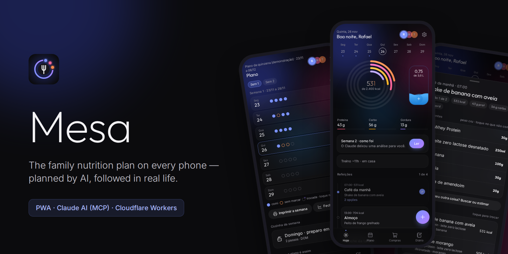
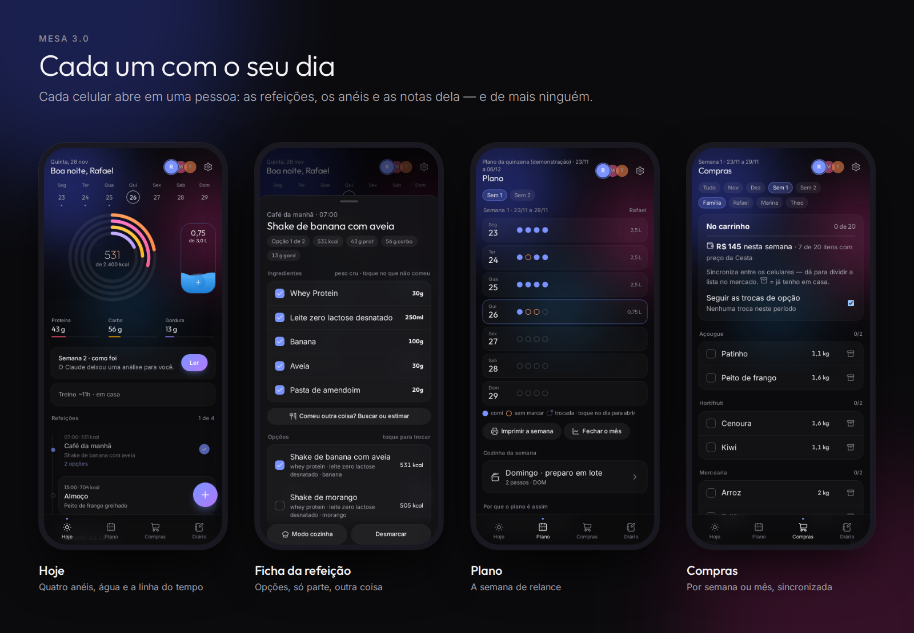
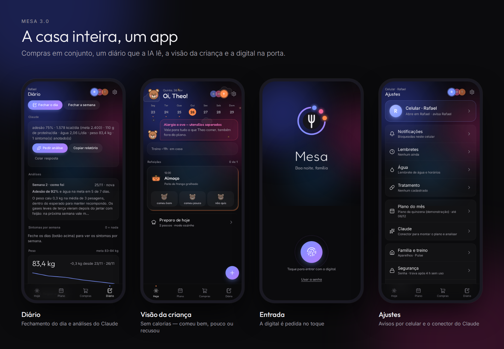
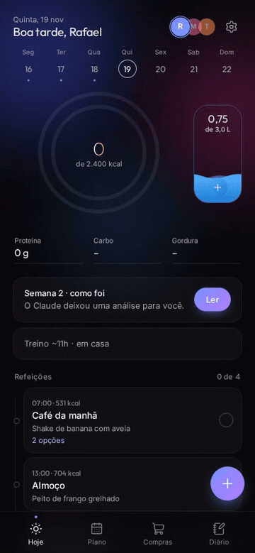
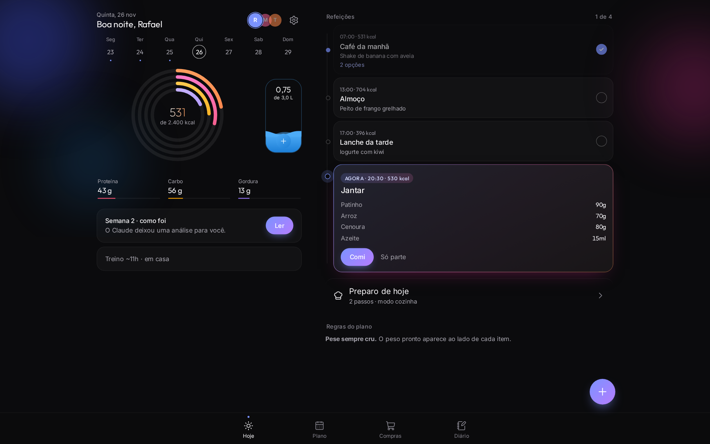
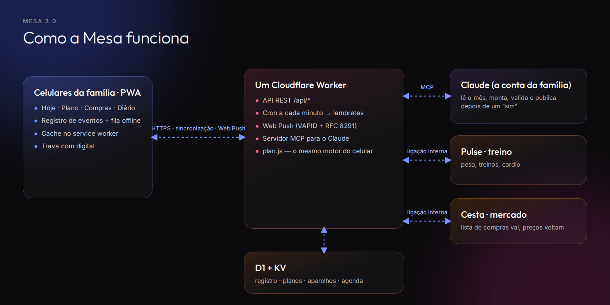
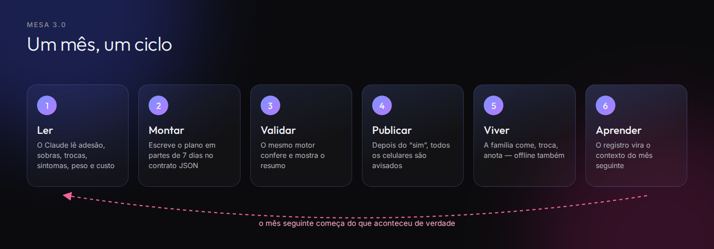

<p align="center"></p>

<p align="center">
  <a href="https://bebernos.github.io/Mesa-Business/"><b>▶ Demonstração ao vivo</b></a> ·
  <a href="README.md">Read in English</a> ·
  <a href="#telas">Telas</a> ·
  <a href="#como-funciona">Arquitetura</a> ·
  <a href="SECURITY.md">Segurança</a> ·
  <a href="docs/case-study.pt-BR.md">Estudo de caso</a>
</p>

<p align="center">
  
  
</p>

# Mesa

**A Mesa transforma o plano alimentar do mês num app em que a casa inteira vive.** Cada celular abre em uma pessoa — as
refeições, as porções, os anéis e as anotações dela, de mais ninguém. A família divide uma lista de compras só. E o plano
do mês seguinte é escrito pelo próprio Claude da família, que lê pelo conector MCP o que aconteceu de verdade neste mês.

Feita para uma família de verdade e usada todo dia desde outubro de 2026: dois adultos e uma criança em três planos
diferentes, dois celulares, uma cozinha. A **Mesa 3.0** (novembro de 2026) refez a interface inteira em volta de uma pele
escura, a "Órbita", com uma entrada nova em que a digital é pedida no toque, quatro anéis de macros e uma regra mais
firme: o que é de uma pessoa fica só na tela dessa pessoa.

**Em números:** 22 versões · uso diário desde out/2026 · 3 pessoas com planos diferentes · 0 dependências ·
44 testes do Worker e do motor + uma bateria de ponta a ponta com cerca de 90 checagens em todo PR

> A demonstração ao vivo usa uma **família fictícia** (Rafael, Marina e Theo) e um plano que sempre acompanha a data de
> hoje. Tudo acontece no seu navegador — a API do servidor é simulada e nada é enviado.

## Telas

<p align="center"></p>
<p align="center"></p>

<p align="center"><br>
<i>Troca o café de hoje pela opção 2, marca como comido, anota a água — os anéis, a semana e a lista de compras acompanham.</i></p>

<p align="center"><br>
<i>No computador, o painel do dia e a linha do tempo ficam lado a lado.</i></p>

## O que faz

**Hoje** — uma linha do tempo por pessoa: a refeição da vez (*agora*; tocar em qualquer parte abre a ficha), o resto do
dia, as doses do tratamento e os sintomas no horário. Quatro anéis — calorias, proteína, carbo e gordura — e a garrafa
de água com a sequência de dias na meta. Se o plano chega sem carbo ou gordura, a Mesa estima pelos ingredientes
(conferido contra um mês de valores escritos pela IA: cerca de 5 g de diferença por refeição).

**Ficha da refeição** — porções em peso cru e pronto, opções para trocar, "comi só parte" (desmarca o que sobrou) e
"outra coisa": busca numa tabela offline de comidas comuns no Brasil e de redes, soma vários itens com quantidade, ou
estima por tipo e tamanho. Tudo fica marcado como estimativa, para a IA refinar.

**Plano** — a semana em bolinhas (comeu, pulou, trocou), o preparo em lote com cronômetro no modo cozinha de letra grande,
as notas "por que o plano é assim" e a semana para imprimir.

**Compras** — uma lista para a casa, por semana, por mês do calendário ou do plano inteiro, filtrada por pessoa. Segue as
opções escolhidas, sabe o que já tem em casa, sincroniza na hora entre os celulares para duas pessoas dividirem o mercado
e mostra o custo vindo do app de mercado da família.

**Diário** — fechar o dia (energia, humor, sintomas) e a semana, padrões comida × sintoma, testes de reintrodução
guiados, o peso vindo do app de treino e as análises escritas pelo Claude, que aparecem como cartão na Hoje até serem lidas.

**Visão da criança** — sem calorias: "comeu bem / pouco / recusou" em cada refeição, a alergia sempre à vista e um urso
de mascote.

**Atenta, sem encher** — avisos na hora da refeição que pulam o que já foi comido, com "Comi" e "15 min" na própria
notificação, lembrete de água só quando está atrasado e no máximo duas perguntas por dia.

**Entrada** — o prato se desenha, os três pontos da família entram e a digital só é pedida quando você toca.

## Como funciona

<p align="center"></p>

A Mesa são três peças que se encaixam: um **PWA** em cada aparelho da família, **um Cloudflare Worker** que é ao mesmo
tempo API, agendador, envio de notificações e servidor MCP, e o **próprio Claude da família**, que planeja o mês. Um
módulo só — [`public/js/plan.js`](public/js/plan.js) — entende o plano, e ele roda tanto no celular quanto no Worker.

- **No aparelho** — módulos ES puros desenham as quatro abas a partir do plano normalizado. Cada interação (comeu, troca,
  só parte, água, compra, sintoma, dose) vira um evento num registro local com fila offline, enviado em lotes e puxado
  aos poucos, para os celulares convergirem sem conflitos que a família perceba.
- **Na borda** — o Worker serve o app, a API REST, a verificação da passkey e o endpoint MCP. Um cron roda a cada minuto:
  lembretes das refeições a partir de uma agenda compacta, o aviso de água e as perguntas do dia. O Web Push foi
  implementado do zero (VAPID ES256 + RFC 8291).
- **Dados** — o D1 guarda o registro compartilhado (`kind · day · person · k · v`, vale a última gravação) e os planos;
  o KV guarda aparelhos, inscrições e a agenda dos avisos.
- **Integrações** — o app de treino (Pulse) e o de mercado (Cesta) chamam a entrada `Ponte` da Mesa por ligações privadas
  entre Workers: peso, treinos e cardio chegam; a lista de compras vai e os preços voltam.

<p align="center"></p>

**O ciclo com a IA** — as ferramentas MCP deixam o Claude ler o mês (adesão, sobras, trocas, sintomas, testes, peso, água,
treino, custo), escrever o plano em partes de 7 dias, validar com o mesmo motor que o app usa e publicar só depois do
"sim" do usuário. Todos os celulares são avisados na hora em que ele publica.

### Decisões de projeto

| Decisão | Por quê |
|---|---|
| **O plano é um contrato JSON** | Um mês novo nunca precisa de versão nova do app; a IA não consegue gerar o que o app não entende. |
| **O mesmo motor no celular e no servidor** | O cron, a IA e as telas concordam sobre o que é o almoço — sempre. |
| **MCP, não API paga** | O próprio Claude da família planeja; sem conta de API e sem automatizar a conta de ninguém. |
| **Eventos, não documentos** | Só parte, trocas e compras são eventos → sincronização, offline e análise saem de um modelo só. |
| **Cada um na sua tela** | Tratamentos, testes e notas têm dono; textos compartilhados são filtrados para a saúde de uma pessoa não aparecer no dia de outra. |
| **Estimar e deixar a IA corrigir** | Macros que faltam e "outra coisa" são estimados no celular e marcados, para o próximo plano partir de números melhores. |

## Segurança

Senha da família uma vez por aparelho e depois uma sessão de 4 horas que se renova com o uso; passado isso o app trava e a
digital (WebAuthn, conferida no servidor) é pedida no toque — enquanto os botões das notificações continuam funcionando.
As gravações conferem a `Origin`, só o app de treino parceiro pode emoldurar a Mesa e o endpoint MCP fica atrás de um
segredo que dá para trocar. Detalhes em [SECURITY.md](SECURITY.md).

## Destaques de engenharia

- **Sem framework, sem build, sem dependências** — módulos ES puros, um sprite de ícones desenhado à mão e um design
  system em tokens de CSS.
- **Web Push do zero** — VAPID (ES256) e criptografia RFC 8291 `aes128gcm` com WebCrypto, conferidos nos testes por um
  celular falso que decifra mensagens reais.
- **Um motor, dois ambientes** — o módulo do plano roda no navegador e no Worker, então o servidor responde "o que tem no
  almoço?" para a IA e para o cron.
- **Testada como produto** — 44 testes do Worker e do motor no test runner do Node (KV em memória, D1 sobre
  `node:sqlite`) e uma bateria com Playwright de cerca de 90 checagens: passkey com autenticador virtual, offline,
  gestos, fonte grande, visão da criança, computador. Tudo em todo PR, com os prints guardados como artefato.
- **Imagens tiradas do próprio produto** — as telas e os diagramas deste README são gravados da demonstração por um
  workflow do GitHub Actions ([`scripts/gravar-imagens.mjs`](scripts/gravar-imagens.mjs)).
- **Acessível** — rótulos nos botões de ícone, telas conferidas com a fonte grande do Android, nenhum estado só por cor e
  respeito ao `prefers-reduced-motion`.

## Estrutura

```
public/v3/        o app: telas (views/), componentes (ui.js), pele Órbita (v3.css), tabela de alimentos offline (data/)
public/js/        o motor dividido com o Worker: formato do plano, macros, registro, ações, tratamento, diário
public/sw.js      shell offline, notificações e "compartilhar arquivo com a Mesa"
src/              o Worker: API, cron, Web Push, WebAuthn, servidor MCP, água e perguntas do dia
test/             testes do Worker e do motor no Node; bateria de ponta a ponta com Playwright
demo/, scripts/   a API simulada da demonstração, os geradores de ícone e das imagens do README
```

**Para rodar** — `npm ci`, `npm test`; `npm run dev` sobe o Worker localmente (Wrangler) e `node test/e2e.v3.mjs` roda a
bateria de ponta a ponta contra ele (precisa do Playwright).

## Tecnologias

JavaScript (ES2023, sem framework) · HTML/CSS · Service Worker · Web Push (VAPID, RFC 8291) · WebAuthn · Cloudflare
Workers · D1 · KV · Cron Triggers · Model Context Protocol (MCP) · Claude · Playwright · test runner do Node.js

## Para ler mais

- [Estudo de caso](docs/case-study.pt-BR.md) — o problema, as decisões, o resultado e a repaginação da 3.0.
- [Segurança](SECURITY.md) — modelo de ameaças e como cada camada funciona.
- [Formato do plano](docs/PROMPT-DIETA.md) — o contrato JSON entre a IA e o app.

## O conjunto

| | |
|---|---|
| [**Lastro**](https://github.com/BeBernos/Lastro-Business) | Finanças da família — caixa, cartão e investimentos, com criptografia de ponta a ponta |
| **Mesa** | Plano alimentar da família (este repositório) |
| [**Pulse**](https://github.com/BeBernos/Pulse-Business) | Musculação com programas montados por IA e animações 2D/3D dos exercícios |
| [**Cesta**](https://github.com/BeBernos/Cesta-Business) | Pesquisa de preços, rota de compras e conferência de nota fiscal |

## Sobre

Desenhada e construída por **Bruno Bernos** — produto, UX e engenharia — com o Claude Code como par de programação.
Contato: [github.com/BeBernos](https://github.com/BeBernos).

## Licença

Copyright © 2026 Bruno Bernos. **Todos os direitos reservados.** O código está publicado só para avaliação; não é
concedida permissão para usar, copiar, modificar ou distribuir. Há licenças comerciais (inclusive white-label para
nutricionistas, clínicas e programas de bem-estar corporativo) — veja [LICENSE](LICENSE) e entre em contato.
