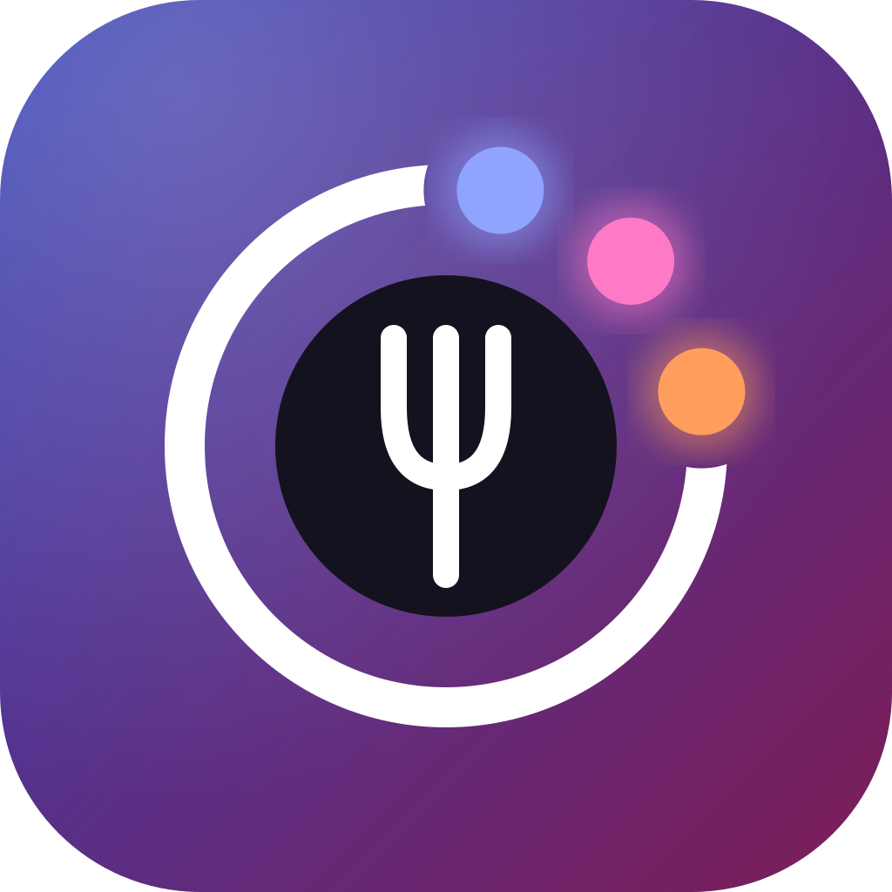
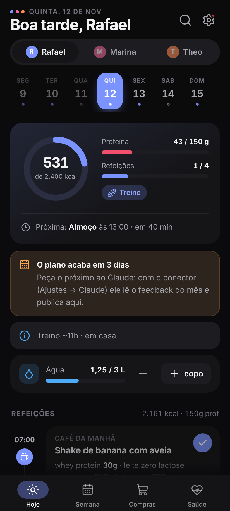
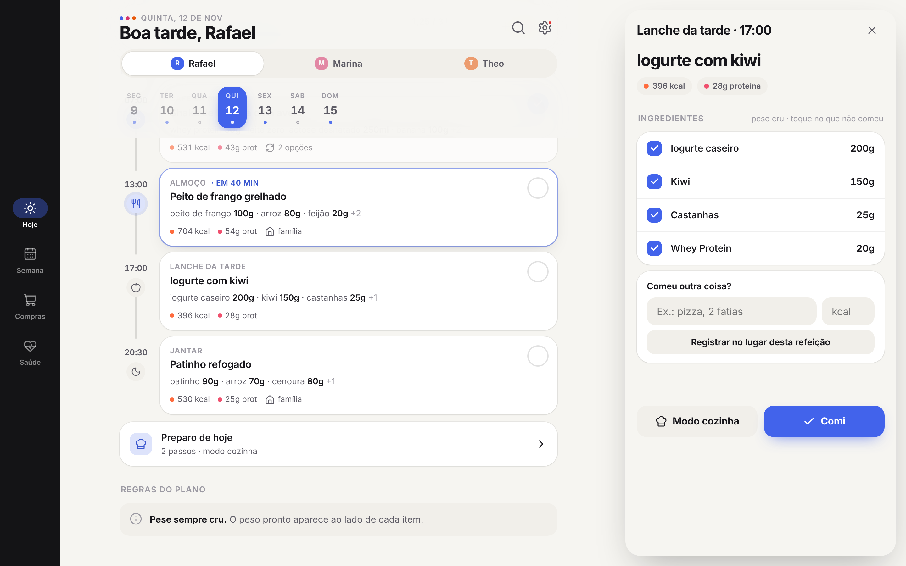
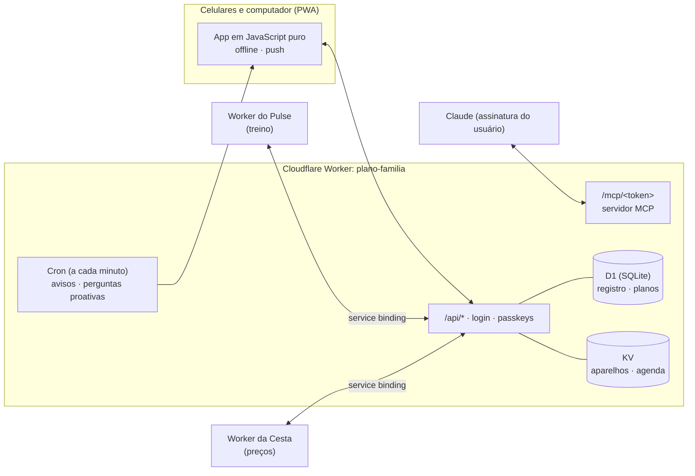

<p align="center"></p>

<h1 align="center">Mesa</h1>
<p align="center"><b>O plano alimentar da família em todos os celulares — montado por IA, seguido na vida real.</b></p>

<p align="center">
  <a href="README.md">🇺🇸 Read in English</a> ·
  <a href="#demonstração">Demonstração</a> ·
  <a href="#arquitetura">Arquitetura</a> ·
  <a href="#uso-comercial">Uso comercial</a>
</p>

<p align="center">
  
  
  
  
  
</p>

---

A Mesa transforma o plano alimentar do mês num app vivo e compartilhado pela casa. Cada pessoa vê as próprias refeições,
porções e metas; a família vê uma lista de compras só; e o plano do mês seguinte é escrito por um assistente de IA que lê
como o mês realmente foi — o que foi comido, pulado, trocado e como as pessoas se sentiram.

> Todos os dados deste repositório e das imagens são fictícios (família de demonstração: Rafael, Marina e Theo).

## Demonstração

<p align="center"></p>

| Hoje | Refeição e opções | Painel do plano | Compras |
|---|---|---|---|
|  |  |  |  |

| Saúde e feedback | Ajustes | Modo escuro | Entrada |
|---|---|---|---|
|  |  |  |  |

**No computador** — a ficha da refeição fica ao lado da linha do tempo:



## O que faz

**No dia a dia**
- Linha do tempo por pessoa: refeições, porções (peso cru e pronto), anel de kcal/proteína contra a meta do dia.
- Um toque marca a refeição como feita (com desfazer); dá para marcar só *parte* da refeição ou "comi outra coisa" — as calorias se ajustam.
- Opções de refeição: troque o café de hoje pela opção 2 ou 3; os totais e a lista de compras acompanham.
- Água, busca ("quando tem frango este mês?"), deslizar entre dias, puxar para atualizar, fila offline.
- Visão da criança: "comeu bem / pouco / recusou" em vez de calorias, alergias sempre à vista.

**Planejamento e casa**
- Lista de compras compartilhada por semana ou do plano inteiro, sincronizada entre os celulares no mercado; "já tenho em casa".
- Preparo em lote: totais da semana (cru e pronto) e temporizadores no modo cozinha; cardápio + lista para imprimir.
- Painel do plano: adesão por semana, média comida contra a meta, peso, hidratação.
- Custo da dieta por semana, com os preços pesquisados no app de mercado ([Cesta](https://github.com/BeBernos/Cesta-Business)).

**Saúde**
- Check-in diário (energia, fome, intestino) e fechamento da semana — a matéria-prima do próximo plano.
- Diário de sintomas com o cruzamento **comida × sintoma**.
- Testes de reintrodução guiados (ex.: FODMAP): aviso no dia da dose, perguntas de acompanhamento, resultado por alimento, histórico.
- Notificações proativas que perguntam em vez de insistir (no máximo 2 por dia, respondidas na própria notificação).

**Plano montado por IA, sem API paga**
- Um **conector MCP** (Model Context Protocol) deixa a assinatura do Claude do próprio usuário ler o contexto da família e
  publicar o plano do mês seguinte: rascunho em partes, validação, resumo e publicação só depois da confirmação.
- O plano é um contrato JSON documentado ([`docs/PROMPT-DIETA.md`](docs/PROMPT-DIETA.md), exemplo em
  [`docs/exemplo-plano.json`](docs/exemplo-plano.json)), validado no servidor e no aparelho.

**Integrações**
- [Pulse](https://github.com/BeBernos/Pulse-Business) (treino): peso oficial, "treinou hoje?", gasto do cardio e a agenda de treino
  (dia de treino ou descanso, horário do pré/pós-treino) por uma ligação privada entre Workers.
- [Cesta](https://github.com/BeBernos/Cesta-Business) (preços de mercado): traz a lista de compras da dieta e devolve os preços.

## Arquitetura



- **Frontend:** PWA em módulos de JavaScript puro — sem framework, sem build, sem dependências. Service worker com shell
  offline, planos em cache e Web Push (botões na notificação: "Comi", "15 min", respostas às perguntas).
- **Backend:** um único Worker do Cloudflare — arquivos estáticos, API REST, cron e servidor MCP. O **D1** guarda o registro
  compartilhado (refeições, compras, peso, sintomas, testes…) com sincronização "vence a última gravação"; o **KV** guarda
  aparelhos e a agenda dos avisos.
- **Web Push do zero:** VAPID (ES256) e criptografia `aes128gcm` (RFC 8291) com WebCrypto.
- **Segurança:** cookie do aparelho + sessão de 4 horas renovável, tela de bloqueio com **passkeys** (WebAuthn conferido no
  servidor), checagem de `Origin` nas gravações, `frame-ancestors` restrito ao app parceiro, conector MCP atrás de um segredo
  que pode ser trocado.
- **Motor do plano:** um módulo só ([`public/js/plan.js`](public/js/plan.js)) usado no navegador e no Worker: validação,
  opções de refeição (inclusive deduzidas do rodízio), estimativa de refeição parcial, lista de compras, lote, custo e análises.

## Qualidade

- `npm test` — test runner nativo do Node contra o código real do Worker (KV em memória, D1 sobre `node:sqlite`, um celular
  de mentira que decifra o Web Push de verdade, conferência de assinatura WebAuthn).
- Duas suítes de ponta a ponta com Playwright contra o `wrangler dev` (autenticador virtual para passkeys, modo offline,
  gestos, fonte grande a 280 px, layout de computador).
- As duas rodam em todo pull request ([`.github/workflows/testes.yml`](.github/workflows/testes.yml)).

## Rodar localmente

```bash
npm install
echo "APP_PASSWORD=escolha-uma-senha" > .dev.vars
npm run dev                         # http://localhost:8787
npm test                            # testes de unidade e do Worker
SHOTS=prints node test/e2e.mesa.mjs # ponta a ponta (precisa do Playwright e do estado do wrangler zerado)
```

Para publicar, basta uma conta do Cloudflare (plano grátis): `wrangler deploy` cria o Worker; KV e D1 estão declarados no
[`wrangler.jsonc`](wrangler.jsonc).

## Uso comercial

Este repositório tem **código visível, mas não é open source**: dá para ler e avaliar o código, mas uso em produção ou
comercial exige licença. Há licenças para **implantações white-label** (nutricionistas, clínicas, serviços de cardápio,
bem-estar corporativo) e para desenvolvimento sob medida. Veja a [LICENSE](LICENSE) e fale comigo pelo
[github.com/BeBernos](https://github.com/BeBernos).

## Faz parte de um conjunto

| | |
|---|---|
| **Mesa** | Plano alimentar da família (este repositório) |
| [**Pulse**](https://github.com/BeBernos/Pulse-Business) | Treino de força com programas montados por IA e animações 2D/3D dos exercícios |
| [**Cesta**](https://github.com/BeBernos/Cesta-Business) | Pesquisa e comparação de preços de supermercado |
